<!-- markdownlint-disable MD041 MD033 -->


# ADR-025: The `real` Datatype: Precision axes and bases

[ADRs](../README.md)

## Status

💡 **Proposed**:

> An idea to be considered for adoption

## Context

`integer` represents all of ℤ. A range constraint lets the backend choose a native representation. `real` should likewise mean all of ℝ, but irrational numbers like π and √2 cannot be stored exactly in finite memory, so a stored `real` needs a precision.

Three concerns must stay separate:

1. The **universe and range** (the `subset`): which values a variable may hold. This decides compatibility.
2. The **representation** (the precision): the grid of exactly representable values the backend lowers to.
3. The **operation semantics**: how arithmetic and rounding behave on those values.

**Terminology.** A `universe` is a top set (`integer`, `real`, `truthvalue`, `rc-type`). A `subset` is a universe plus a range. A `type` is a subset plus, for `real`, a representation. A variable has a `type`, which defines what values it can store and how the backend lowers it.



**One principle governs the rest.** A declared precision is a _minimum_ requirement on resolution, never an exact specification of storage. Lowering may be finer than declared; it is never coarser, and "finer" means _in the same base_ — a grid of another base is not a finer grid, it is a different value set.

## Decision 1: Compatibility and Precision

Compatibility is universe and range; precision is representation

A `subset` of `real` is an exact range, as for `integer`:

```clawr
subset probability = real (0.0...1.0)
```

Precision is written where storage is declared (variables, `data` fields, array elements, parameters, returns), not in the `subset`:

```clawr
mut p: probability scale 5            // multiples of 0.00001
mut q: probability sig 5              // 5 significant digits
mut y: real (1.0...1000.0) sig 15     // bounded and away from zero
mut balance: real scale 2             // unbounded range: lowered to an arbitrary-size integer
mut d: real big                       // arbitrary-size decimal
```

A `type` is a subset plus a representation. **Compatibility is decided by the universe and the range only.** Precision never makes two types incompatible. Equality also compares values and ignores representation, so `1.20` at `scale 2` equals `1.200` at `scale 5`.

**Lowering finer is legal and invisible.** A backend may store a value in any grid that _contains the declared grid as a subset_ — same base, at least as fine. A grid of a different base is not a superset. Rounding is into the _declared_ grid, once (see ADR-026), never into the storage grid. Because of this, `0.10 + 0.20 == 0.30` holds regardless of how much finer the store is.

### Rationale

- Compatibility is determined solely by the universe and range, ensuring that different representations of the same logical type are considered equal.
- Lowering to finer grids allows backends to optimize storage and computation without affecting the declared precision or the semantics of equality.
- Single rounding at storage ensures predictable behavior and avoids cumulative rounding errors during arithmetic operations.
- The distinction between compatibility and precision allows developers to reason about correctness independently of performance optimizations related to storage and computation.

### Consequences

- Ensures that different representations of the same logical type are treated consistently, improving reliability and predictability.
- Allows backends to optimize storage and computation without affecting the declared precision or the semantics of equality.
- Reduces the risk of cumulative rounding errors by enforcing single rounding at storage.
- Provides a clear distinction between compatibility and precision, aiding developers in reasoning about correctness and performance optimizations.

### Alternatives Considered

- Not distinguishing between compatibility and precision, which would simplify the type system but could lead to unexpected behavior when different representations of the same logical type are compared.
- Allowing multiple roundings at different stages of computation, which could provide more flexibility but would complicate reasoning about numerical accuracy.
- Using fixed-size arbitrary-precision decimals, which would simplify backend implementation but reduce flexibility and potentially introduce precision limitations.

## Decision 2: Precision Kinds and Bases

There are two precision kinds over a closed set of bases:

| Kind      | Meaning                                         | Example           |
| --------- | ----------------------------------------------- | ----------------- |
| `scale n` | **Absolute** resolution: multiples of $b^{-n}$  | `scale 2` (cents) |
| `sig n`   | **Relative** resolution: $n$ significant digits | `sig 15`          |

| Keyword | Meaning                          | Base |
| ------- | -------------------------------- | ---: |
| `dec`   | Decimal (the default if omitted) |   10 |
| `bin`   | Binary                           |    2 |
| `ter`   | Balanced ternary (reserved)      |    3 |

A `scale n` precision implies a rational value ($\text{numerator} / \text{denominator}$) where the denominator is $\text{base}^n$ (the declared precision parameters) and only the numerator is actually stored in the representation.

A `sig n` precision does not imply any specific representation. The backend may choose freely as long as it is capable of storing the entire range with at least the requested precision. (Except for a floor to avoid arbitrarily small values.)

The floor near zero is a machine delta ($\delta$) that may vary by platform. A ternary processor necessarily yields a different delta from binary for the ame type. Values in $(-\delta, \delta)$ are not representable and trigger panic at storage. The runtime delta is guaranteed to be smaller than a documented maximum $\delta (n, b, \text{range})$. How to document that is still an open question. The guaranteed delta should be small enough that it does not allow sloppy implementation, but big enough that it allows a type that exactly matches the range and precision of an IEEE representation to actually use that representation.

### Rationale

- Any `real` number can be expressed on the form $m \cdot b^e = m / b^{-e}$.
- A `sig n` grid cannot extend to arbitrarily small magnitudes in fixed-size storage. A delta is necessary.
- The runtime delta can vary by platform: a binary processor will necessarily have a different delta from a ternary one. Defining a maximum value for the delta minimizes the risk of unpleasant surprises.
- The distinction between absolute (`scale n`) and relative (`sig n`) precision allows developers to choose the appropriate trade-off between fixed resolution and significant digits, depending on the application's requirements.
- By documenting the `delta(n, b, range)`, developers have a clear understanding of the smallest representable value and can reason about the behavior of arithmetic operations near zero.

### Consequences

- Enforces a consistent and predictable behavior for arithmetic operations, reducing the likelihood of subtle bugs related to precision and rounding.
- Simplifies reasoning about numerical accuracy by ensuring that all values are rounded only once at storage.
- May introduce performance overhead due to the need for explicit conversions and rounding when dealing with cross-base operations.
- Limits flexibility in intermediate computations, as multiple roundings at different stages are not allowed.

### Alternatives Considered

- Allowing multiple roundings at different stages of computation, which could provide more flexibility but would complicate reasoning about numerical accuracy.
- Supporting implicit cross-base conversions, which would improve convenience but could introduce hidden performance costs and reduce clarity.
- Using fixed-size arbitrary-precision decimals, which would simplify backend implementation but reduce flexibility and potentially introduce precision limitations.

## Decision 3: Exact Values and Single Rounding at Storage

### 3. Semantics: exact values, one rounding at storage

Every representation is a **canonical grid.** Arithmetic computes the exact result, and rounding happens once, when a value is stored in a grid.

- **Cross-base operands are rejected.** An arithmetic expression whose operands' bases differ is a compile error unless one operand is explicitly converted via `round(x, to: ...)`. This enforces strict clarity and avoids hidden translation costs.
- **Division and square root are not exact.** A bare `/` between `real big` values requires a target grid or named call (`divide(a, by: b, to: sig 20 dec)`).
- **NaN, ±∞ and signed zero do not exist** for reals. Division by zero, overflow, and underflow panic.
- **Rounding:** One default mode (round to nearest, ties to even), plus an explicit `round(x, mode: ...)`.

### Rationale

While it is easy to create a common scale factor as the LCM of the operand scale-factors, there is no general way to reduce the result to a `dec`, `bin`, or `ter` scale. At least not if ternary is an alternative.

### Consequences

- Ensuring exact values and single rounding at storage simplifies reasoning about numerical behavior and avoids cumulative rounding errors.
- Rejecting cross-base operands without explicit conversion prevents hidden performance costs and maintains clarity in arithmetic expressions.
- By not supporting NaN, ±∞, and signed zero, the model enforces strict correctness and eliminates special-case handling in numerical computations.
- The single rounding at storage ensures that arithmetic operations are predictable and consistent across different hardware and software backends.

### Alternatives Considered

- Allowing implicit cross-base conversions, which would improve convenience but could introduce hidden performance costs and reduce clarity.
- Supporting NaN, ±∞, and signed zero, which would increase compatibility with standard floating-point semantics but complicate reasoning and special-case handling.
- Using fixed-size arbitrary-precision decimals, which would simplify backend implementation but reduce flexibility and potentially introduce precision limitations.

## Decision 4: Assignment, Equality, and Literals

- **Range is checked as type compatibility** (compile-time where provable, otherwise dynamic panic).
- **Precision check at assignment is _exactness_:** the value must lie on the target grid.
- **Precision is lost only explicitly**, with `round(x, to: ...)`. Across bases (`dec`, `bin`, `ter`) `round` is required at compile time. It is a **compile-time no-op** when the source denominator divides a power of the target base (`bin → dec` is always a no-op; `dec → bin` and `ter → dec` genuinely round).
- **Equality** compares values exactly, making it transitive and independent of representation. `isclose(a, b, tol)` is a library function.
- **Literals** are exact values checked against the target grid, with exact rational folding for `const` arithmetic.

### Rationale

- Assignment enforces that values conform to the target grid, ensuring that precision is maintained and any necessary rounding is explicit.
- Equality checks are exact, providing predictable and consistent behavior regardless of the underlying representation.
- Literals are validated against the target grid at compile-time, allowing for early detection of precision mismatches and ensuring that constant expressions are correctly folded.

### Consequences

- Inferring a singleton subset for `const` declarations allows the compiler to optimize aggressively while ensuring constant values remain unchanged.
- Requiring explicit precision for `mut` declarations prevents unintended precision loss and enforces clarity in variable representation.
- This approach provides a balance between safety and flexibility, enabling efficient and correct numerical code while maintaining control over precision and representation.

### Alternatives Considered

- Not inferring a singleton subset for `const` declarations, which would reduce compiler optimizations but simplify the type system.
- Allowing implicit precision for `mut` declarations, which would increase convenience but could lead to unintended precision loss and less predictable behavior.

## Decision 5: Inference

- `const x = 1.25` infers a singleton subset plus the literal's own precision (`sig n`).
- `mut` declarations require an explicit precision because a variable needs a representation for every future assignment. An unconstrained `mut a: real` is rejected.

### Rationale

- By inferring a singleton subset for `const` declarations, the compiler can perform aggressive optimizations and ensure that the value remains constant throughout its lifetime.
- Requiring explicit precision for `mut` declarations enforces clarity and prevents unintended loss of precision during assignments, ensuring that the variable always has a well-defined representation.
- This approach balances safety and flexibility, allowing developers to write efficient and correct numerical code while maintaining control over precision and representation.

### Consequences

- `const` declarations benefit from aggressive compiler optimizations due to the inferred singleton subset.
- `mut` declarations maintain explicit precision, preventing unintended precision loss and ensuring clarity in variable representation.
- Developers have a clear understanding of the precision and representation of their variables, leading to more predictable and correct numerical code.

### Alternatives Considered

- Not inferring a singleton subset for `const` declarations, which would reduce compiler optimizations but simplify the type system.
- Allowing implicit precision for `mut` declarations, which would increase convenience but could lead to unintended precision loss and less predictable behavior.
- Using a different approach for balancing safety and flexibility, such as introducing additional type annotations or constraints for numerical variables.

## Decision 6: `real big`

`real big` is an arbitrary-size decimal residing in the `real` universe, heap-lowered (`Real*`) with copy-on-write semantics.

### Rationale

The design of `real big` as an arbitrary-size decimal with exact intermediate representations and single rounding at storage ensures that computations are precise and predictable. By rejecting cross-base operations unless explicitly converted, the language enforces clarity and prevents hidden performance costs. This approach balances correctness with performance, providing a robust framework for numerical computations across different bases.

### Consequences

- `real big` provides exact intermediate representations, ensuring precise and predictable computations.
- Single rounding at storage simplifies reasoning about numerical behavior and avoids cumulative rounding errors.
- Cross-base operations are rejected unless explicitly converted, preventing hidden performance costs and maintaining clarity.
- The design enforces strict correctness by not supporting NaN, ±∞, and signed zero, eliminating special-case handling in numerical computations.
- Backends need to handle exact intermediates and copy-on-write semantics, which may introduce additional complexity.
- Developers have a clear and consistent framework for performing high-precision arithmetic, leading to more reliable numerical code.

### Alternatives Considered

- Using fixed-size arbitrary-precision decimals, which would simplify backend implementation but reduce flexibility and potentially introduce precision limitations.
- Allowing NaN, ±∞, and signed zero, which would increase compatibility with standard floating-point semantics but complicate reasoning and special-case handling.
- Implicit cross-base conversions, which would improve convenience but could introduce hidden performance costs and reduce clarity.
- Using mutable arbitrary-size decimals without copy-on-write semantics, which could simplify memory management but might lead to unintended side effects and less predictable behavior.
- Using a hybrid approach with both fixed-size and arbitrary-size decimals, which could offer a balance between performance and flexibility but would increase the complexity of the type system and backend implementation.

## Related ADRs

- [`subset`](./drafts/subset.md)
- [ADR-026](./adr-026.md) (Backend Execution Mechanics and Lowering for Reals)
